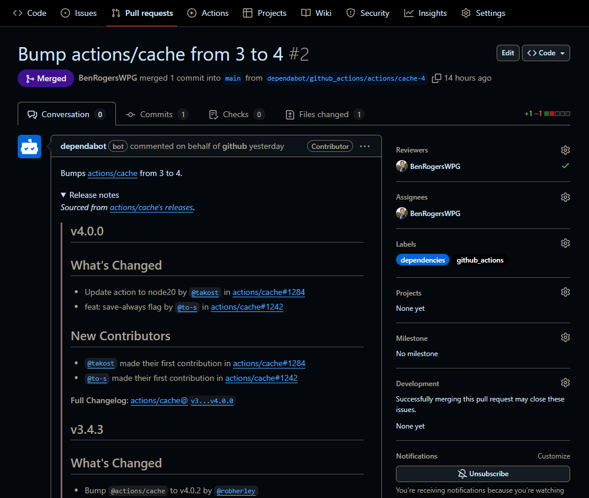

# pip Update Notifier

This project will *automatically* notify you in the form of a pull request when your favorite Python packages (pip) are updated.

<!---->

## How To Use
1. Fork this repository.
2. Update the pinned packages in the appropriate group in [pyproject.toml](/src/pyproject.toml). The `base`, `gm`, `bfg`, `har`, `tbwp`, and `wm` groups replace the former `requirements*.in` files.
3. Regenerate the lock file:
   ```bash
   uv lock
   ```
   Commit both `pyproject.toml` and `uv.lock`.
4. Set up and run Dependabot, specifically targeting pip packages.
   1. Go to your forked repository on GitHub.
   2. Click on the "Settings" tab.
   3. On the left sidebar, click on "Code Security".
   4. Under the Dependabot section, enable the very last entry, "Dependabot version updates".
   5. Enable other dependabot options if you want to be notified on other aspects of your repository too. Also important if you want to be notified on security vulnerabilities.

## What It Does
When the above is all set up, you will receive a pull request when any of the packages you are monitoring are updated. The pull request will contain the following information:
- The name of the action that was updated.
- The version that was updated to.
- The link to the action's repository.
- The full action changelog between the version you are on and the version you are being updated to.
- The release notes of the version since your last update, including what has changed, what has been fixed, and what has been added.
- A full list of all the commits that have been made since your last update.
- A compatibility percentage with your current version.
- A list of all the files that have been changed in the action's repository since your last update.

### Run Dependabot
- Once you are all set, [run dependabot](../../network/updates) and try it out 🤖!

### Improves Security
- This project improves your application security by locking Python packages to current-approved versions in `uv.lock` and requiring user intervention before new versions are used, preventing things like pulling latest potentially unsafe compromised/untested versions.

## You Are In Control
You choose what notifications you want. You can monitor only the full releases (eg. from 3.1.5 to 4.0.0) or the patch releases (eg. from 3.1.5 to 3.1.6). You can choose this per package too, so you can get as-granular as you want for the packages you care about the most. Edit that package's exact version pin in the appropriate dependency group in [pyproject.toml](/src/pyproject.toml), then run `uv lock`.


*This project is based off of my [pip Update Notifier](https://github.com/BenRogersWPG/pip-Update-Notifier).*

[](https://github.com/BenRogersWPG/pip-Update-Notifier/actions/workflows/dependabot/dependabot-updates)
